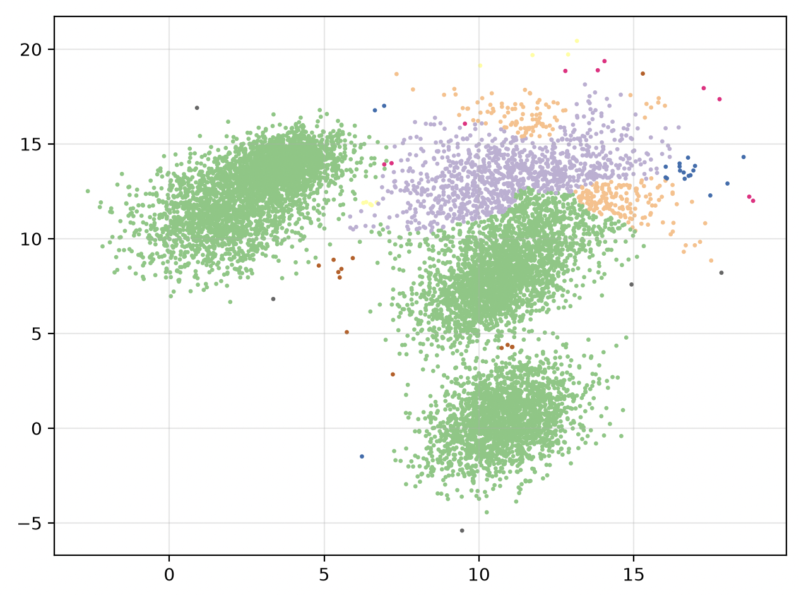
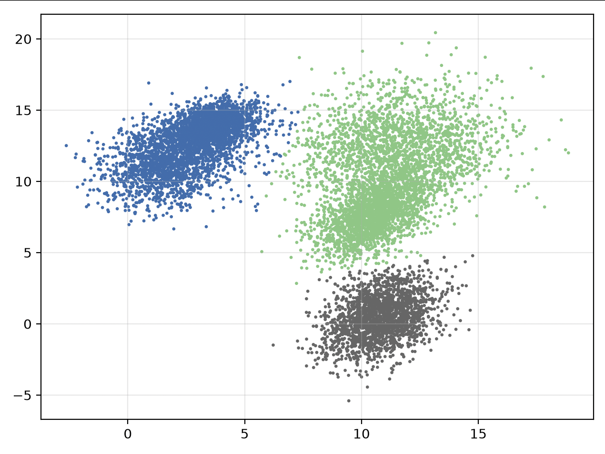
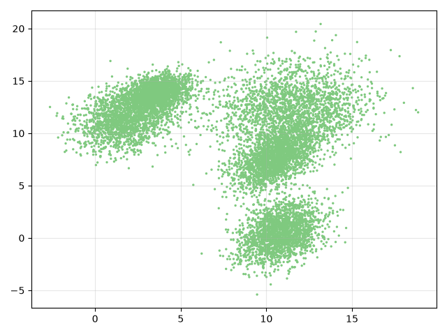

# Génération de textures - Effros Leung

## Texture 0
|threshold/window size|5|9|15|
|---------------------|-|-|--|
|0.3| | | |
|0.1| | | |
|0.01| | | |

## Texture 1
|threshold/window size|5|9|15|
|---------------------|-|-|--|
|0.3| | | |
|0.1| | | |
|0.01| | | |

## Texture 2
|threshold/window size|5|9|15|
|---------------------|-|-|--|
|0.3| | | |
|0.1| | | |
|0.01| | | |

## Texture 3
|threshold/window size|5|9|15|
|---------------------|-|-|--|
|0.3| | | |
|0.1| | | |
|0.01| | | |

## Texture 4
|threshold/window size|5|9|15|
|---------------------|-|-|--|
|0.3| | | |
|0.1| | | |
|0.01| | | |

## Texture 5
|threshold/window size|5|9|15|
|---------------------|-|-|--|
|0.3| | | |
|0.1| | | |
|0.01| | | |

## Texture 6
|threshold/window size|5|9|15|
|---------------------|-|-|--|
|0.3| | | |
|0.1| | | |
|0.01| | | |

## Texture 7
|threshold/window size|5|9|15|
|---------------------|-|-|--|
|0.3| | | |
|0.1| | | |
|0.01| | | |

## Résultats
Pour les textures stochastiques : une petite fenêtre suffit et un grand threshold peut fonctionner (induit beaucoup d'aléatoire)
Pour les textures avec des grand patterns (ex : pomme) : il faut obligatoirement une grand fenêtre

# Classification - mean-shift
## Classification 2D
| h = 1 | h = 2 | h = 3 | h = 4 |
|-------|-------|-------|-------|
|| | |  |

## Classification des textures
### Filtres de Gabor
Détection des variation dans toutes les direction et à différentes fréquences

### Résultats
### Classification de 10 images, découpées en 20 patches de 64px
|h| nb clusters | bien classifiés DO | unicité DO | bien classifié DT | unicité DT|
|-|-------------|--------------------|------------|---------------|------------|
| 2 | 33 | 0.88 | 0.57 | 0.88 | 0.54 | 
| 2.25 | 21 | 0.85 | 0.61 | 0.88 | 0.64 | 
| **2.5** | **14** | **0.74** | **0.79** | **0.79** | **0.73** | 
| 2.75 | 10 | 0.66 | 0.85 | 0.69 | 0.75 | 
| 3 | 9 | 0.52 | 0.82 | 0.59 | 0.88 | 

#### Visualisation
|2|2.25|2.5|2.75|3|
|-|----|---|----|-|
||||||

> Possibilité de fusionner des clusters ?
> Refaire un meashift ?

## Classification des textures générées
### Classification de 10 images, découpées en 20 patchs de 16px
|h| nb clusters | bien classifiés DO | unicité DO | bien classifié DT | unicité DT|
|-|-------------|--------------------|------------|---------------|------------|
| 2 | 93 | 0.81 | 0.28 | 0.64 | 0.31 | 
| **2.5** | **46** | **0.68** | **0.37** | **0.67** | **0.46** | 
| 3 | 27 | 0.62 | 0.56 | 0.59 | 0.57 | 
| 4 | 9 | 0.53 | 0.76 | 0.54 | 0.77 | 

### Classification de 10 images, découpées en 5 patchs de 32px
#### Résultats de la classification
|h| nb clusters | bien classifiés DO | unicité DO | bien classifié DT | unicité DT|
|-|-------------|--------------------|------------|---------------|------------|
| 2 | 17 | 0.64 | 0.76 | 0.57 | 0.81 | 
| **2.5** | **14** | **0.60** | **0.84** | **0.52** | **0.86** | 
| 3 | 11 | 0.56 | 0.89 | 0.51 | 0.93 | 
| 4 | 7 | 0.46 | 0.89 | 0.46 | 0.96 | 

> Plus la taille du patch est grande, plus il est possible de détecter les patterns avec les filtres de gabor, donc plus la classificaiton est correcte
> /!\ Le nombre de patch totaux a aussi été modifié, mais la conclusion reste la même
> mais le traitement est plus long

#### Visualisation
|h=2|h=2.5|h=3|h=4|
|-|---|-|-|
|||||

